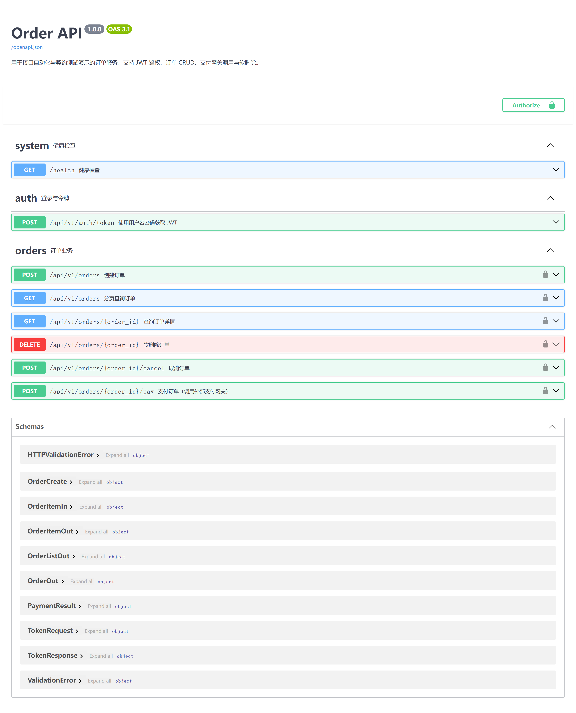
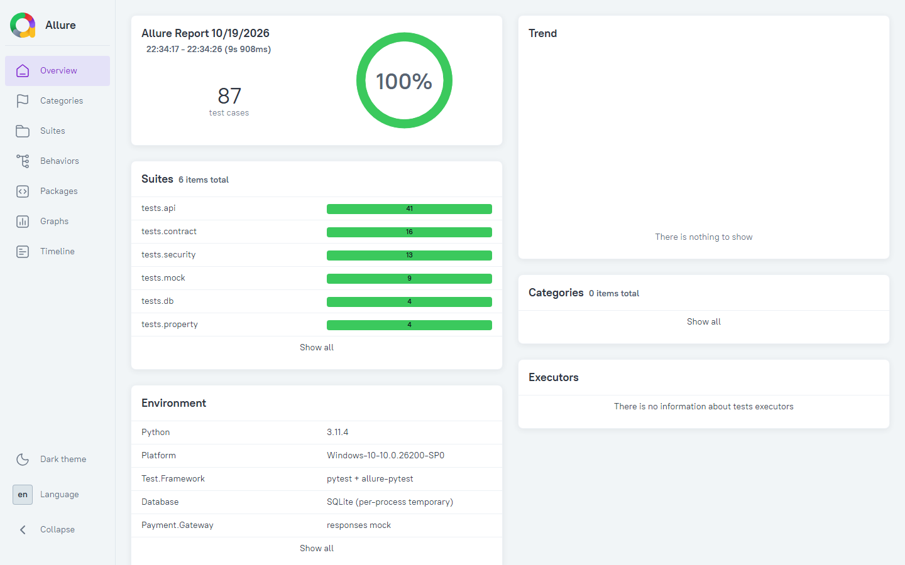

# 接口自动化 + 契约测试框架（Order API）

一个可以直接运行、演示、进 CI 的接口测试项目：包含一个真实可跑的 FastAPI 订单服务，以及围绕它构建的 **HTTP 自动化、JSON Schema 契约测试、数据库校验、外部支付网关 Mock、Hypothesis 属性测试、接口安全基线** 六层测试体系。

项目重点不是“多写几个 requests 断言”，而是展示企业接口测试中真正有价值的工程能力：

- 用 **契约测试** 在服务提供方与消费方之间建立可执行的字段约定；
- 用 **数据库断言** 验证接口行为真正落库，而不是只相信响应体；
- 用 **故障注入** 覆盖支付超时、网关 5xx、非 JSON、缺失流水号等异常分支；
- 用 **属性测试** 自动生成大量合法订单，验证金额计算、状态流转等不变量；
- 用 **安全基线** 覆盖批量赋值、SQL 注入、畸形 JWT、错误信息泄露与安全响应头；
- 用 **CI + Allure + 覆盖率门禁 + Docker** 形成完整交付链路。

---

## 验证结果

本地实测环境：Python 3.11.4 / Windows 11 / Pytest 9.1.1

```text
87 passed in 13.03s
app 服务端代码覆盖率：100%（247 statements，0 miss）
可选第三方契约用例：2 passed
```

| 测试分层 | 目录 | 用例数 | 关注点 |
|---|---|---:|---|
| HTTP 端到端 | `tests/api/` | 41 | JWT 鉴权、订单 CRUD、分页过滤、边界值、Unicode、金额舍入 |
| 契约测试 | `tests/contract/` | 16 | JSON Schema、OpenAPI 规范、Provider/Consumer 字段一致性、额外字段拦截 |
| 数据库校验 | `tests/db/` | 4 | 主从表落库、金额、软删除、状态流转 |
| 外部依赖 Mock | `tests/mock/` | 9 | 支付成功、500、超时、非 JSON、缺失流水号、重复支付 |
| 接口安全基线 | `tests/security/` | 13 | 批量赋值、SQL 注入、畸形 JWT、错误信息泄露、安全响应头 |
| 属性测试 | `tests/property/` | 4 | 金额不变量、商品顺序无关、取消终态、软删除不可见 |
| 第三方契约（可选） | `external_tests/` | 2 | JSONPlaceholder 公开 API 契约校验 |

> `external_tests/` 依赖外网，默认不进入主测试集，只在 CI 定时任务或手动触发时运行。



---

## 架构

```text
┌──────────────────────────────── pytest ────────────────────────────────┐
│ tests/api        HTTP 端到端：鉴权 / CRUD / 分页 / 参数校验              │
│ tests/contract   消费者 JSON Schema + OpenAPI Provider 校验             │
│ tests/db         SQLAlchemy 直连测试库，断言真实落库与软删除             │
│ tests/mock       responses 拦截支付网关，注入成功与各类故障              │
│ tests/security   批量赋值、注入、畸形 JWT、错误泄露与安全响应头          │
│ tests/property   Hypothesis 自动生成订单，验证金额与状态不变量            │
└───────────────────────────────┬────────────────────────────────────────┘
                                │ HTTP（requests + GET 重试 + Allure 日志）
┌───────────────────────────────▼────────────────────────────────────────┐
│ FastAPI Order API（真实 uvicorn 进程内后台线程）                        │
│ JWT 鉴权 / 订单 CRUD / 取消 / 支付编排 / 软删除 / OpenAPI 3.1           │
└───────────────────────┬───────────────────────────────┬────────────────┘
                        │ SQLAlchemy                    │ requests
                ┌───────▼────────┐              ┌───────▼────────────────┐
                │ SQLite 测试库   │              │ 支付网关（Mock/真实）   │
                │ 每个 worker 隔离│              │ responses 故障注入      │
                └────────────────┘              └────────────────────────┘
```

### 为什么自带被测服务？

企业项目里的接口测试通常依赖下游服务、测试环境和测试数据，容易出现“环境不稳定 → 用例失败 → 没人信自动化”的循环。这个项目把 SUT（System Under Test）一起放进仓库：

- 任何机器 `pip install` 后即可跑，CI 结果稳定；
- 可以真实断言数据库、真实调用外部网关，再对网关做 Mock；
- 面试时可以完整讲清楚“从接口到数据库、从正常流到异常流”的测试设计，而不是只展示脚本。

服务本身保持简单，测试框架才是重点。

---

## 快速开始

```bash
# 1. 安装依赖（建议使用虚拟环境）
python -m venv .venv
# Windows
.venv\Scripts\activate
# macOS / Linux
# source .venv/bin/activate

pip install -r requirements.txt

# 2. 跑完整测试集
pytest

# 3. 打开报告
#    - pytest-html: reports/report.html
#    - 覆盖率:     reports/coverage/index.html
#    - Allure:     见下方命令
```

### 一键运行（Windows）

```bat
run-tests.bat
open-report.bat
```

`run-tests.bat` 会自动查找虚拟环境、运行 pytest、生成 Allure 报告；`open-report.bat` 直接打开报告。macOS / Linux 使用：

```bash
./run-tests.sh
```

如果本机没有全局 Allure CLI，两个脚本都会自动回退到 `npx allure-commandline`。

测试会自动完成：

1. 创建临时 SQLite 数据库并建表；
2. 在后台线程启动真实 uvicorn，等待 `/health` 就绪；
3. 登录获取 JWT；
4. 执行用例；
5. 每个用例结束后清理订单数据；
6. 生成 pytest-html、覆盖率、Allure 结果。

### 启动服务本身

```bash
uvicorn app.main:app --reload
```

- Swagger UI: <http://127.0.0.1:8000/docs>
- OpenAPI JSON: <http://127.0.0.1:8000/openapi.json>
- 健康检查: <http://127.0.0.1:8000/health>

---

## 常用命令

```bash
# 一键跑完整测试 + 生成 Allure 报告
run-tests.bat

# 按标记运行
pytest -m smoke              # 核心冒烟
pytest -m contract           # 契约测试
pytest -m db                 # 数据库校验
pytest -m mock               # 外部依赖 Mock
pytest -m security           # 接口安全基线
pytest -m property           # Hypothesis 属性测试
pytest -m regression         # 回归用例

# 按目录运行
pytest tests/api -q
pytest tests/contract -q

# 并行执行（每个 worker 使用独立数据库和端口）
pytest -n auto -q

# 可选：第三方公开 API 契约测试（需要外网）
pytest external_tests -q -o addopts=""
```

### Allure 报告

```bash
npx --yes allure-commandline generate allure-results -o allure-report --clean
npx --yes allure-commandline open allure-report
# 或者直接起服务：npx --yes allure-commandline serve allure-results
```

如果本机已安装 Allure CLI，也可以：

```bash
allure serve allure-results
```



---

## 被测接口

| 方法 | 路径 | 说明 | 鉴权 |
|---|---|---|---|
| GET | `/health` | 健康检查 | 否 |
| POST | `/api/v1/auth/token` | 用户名密码换取 JWT | 否 |
| POST | `/api/v1/orders` | 创建订单，服务端计算总价 | JWT |
| GET | `/api/v1/orders/{id}` | 查询订单详情 | JWT |
| GET | `/api/v1/orders` | 分页列表，支持 `status`、`customer_id`、`limit`、`offset` | JWT |
| POST | `/api/v1/orders/{id}/cancel` | 取消订单 | JWT |
| POST | `/api/v1/orders/{id}/pay` | 调用支付网关并更新订单 | JWT |
| DELETE | `/api/v1/orders/{id}` | 软删除订单 | JWT |

业务规则：

- 订单金额由服务端根据明细计算，客户端不能直接传总价；
- 只有 `PENDING` 订单可以支付；
- 支付成功 → `PAID`，网关错误/超时 → `FAILED`；
- 已支付订单不能取消、不能删除；
- 删除是软删除，数据库保留记录，接口查询返回 404；
- 列表默认排除软删除订单。

默认账号（可通过环境变量覆盖）：`admin / admin123`。

---

## 六层测试设计

### 1. HTTP 端到端：`tests/api/`

- JWT 登录成功/失败、缺失 Token、伪造 Token、过期 Token、缺少 `sub` 的 Token；
- 创建、查询、列表、过滤、分页、取消、软删除、404/409；
- 分页 `limit/offset` 边界、Unicode 客户 ID/SKU、重复 SKU、金额两位小数舍入；
- 参数化非法用例：空明细、数量/单价越界、空/超长 `customer_id`、缺字段、非法币种、超过 20 行；
- 数据驱动用例放在 `data/order_cases.yaml`，用例与数据分离。

### 2. 契约测试：`tests/contract/`

契约文件位于 `schemas/`：

| 文件 | 约束对象 |
|---|---|
| `order.json` | 单个订单响应 |
| `order_list.json` | 分页列表响应（通过 `$ref` 复用订单契约） |
| `token.json` | 登录响应 |
| `error.json` | 统一错误响应 |
| `payment_result.json` | 支付结果 |
| `post.json` | 第三方 JSONPlaceholder 响应 |

实现要点：

- 使用 JSON Schema **Draft 2020-12**，`$ref` 通过 `referencing.Registry` 跨文件解析；
- 使用 `FormatChecker` 做格式校验；
- 用 `openapi-spec-validator` 校验服务端 `/openapi.json` 是合法的 OpenAPI 3.1 文档；
- 把 OpenAPI 中 `OrderOut` 的必填字段、属性集合与消费者契约逐项比对，防止提供方悄悄删字段/改名；
- 内置一条“破坏性变更”反例，证明契约校验确实能拦住缺字段的响应，而不是永远为真。

这属于 **Schema-based contract testing**。它比普通响应断言更适合微服务场景：字段类型、必填项、枚举值一旦被破坏，CI 会直接失败，而不是等联调时才发现。后续可升级为 Pact 的 consumer-driven contract + Broker。

### 3. 数据库校验：`tests/db/`

不只看接口返回，还直连测试库验证：

- 订单主表字段、总金额、初始状态、时间戳；
- 订单明细表的 SKU、数量、单价、小计；
- 取消订单后状态变为 `CANCELLED`，数据仍在；
- 删除后 `is_deleted = true`，记录数不变（软删除的本质）；
- 多笔订单写入多条独立记录。

### 4. 外部依赖 Mock：`tests/mock/`

`responses` 在进程内拦截 `requests`，同时用 `add_passthru` 放行本地被测服务。覆盖：

- 网关成功：断言订单 `PAID`、流水号写入响应和数据库；
- 网关 500：接口返回 502，订单落库为 `FAILED`；
- 网关超时：接口返回 504，订单落库为 `FAILED`；
- 网关返回 HTML/非 JSON：返回 502；
- 网关返回 JSON 但没有 `reference`：返回 502；
- 重复支付：第二次返回 409，且不会重复调用网关；
- 已支付订单取消/删除均返回 409；
- 已取消订单不能支付。

同时断言发给网关的请求体（`order_id`、`amount`、`currency`），确保不是“只要返回成功就算通过”。

### 5. 接口安全基线：`tests/security/`

不是完整渗透测试，而是把最容易回归的 API 安全风险纳入日常 CI：

- 批量赋值：请求额外传 `status=PAID`、`total_amount=0.01`、`is_deleted=true`，验证服务端忽略并落库为真实计算值；
- SQL 注入：`customer' OR '1'='1` 作为普通客户 ID 保存和查询，验证参数化查询不泄露其他数据；
- 畸形鉴权：Basic、空 Bearer、错误 Scheme、非法 JWT 统一返回 401；
- 信息暴露：404/422 响应不包含堆栈、SQL、绝对路径、口令或依赖路径；
- 安全响应头：`X-Content-Type-Options`、`X-Frame-Options`、`Referrer-Policy`、`Permissions-Policy`、`Cache-Control`；
- OpenAPI 文档不泄露 `JWT_SECRET`、`DATABASE_URL` 等配置。

### 6. 属性测试：`tests/property/`

使用 Hypothesis 自动生成合法订单（1-20 行、数量 1-100、单价按“分”生成），验证不依赖具体样例的业务不变量：

- 任意合法订单的总价 = 各明细小计之和，且每条明细小计正确；
- 商品行顺序变化不影响总价；
- 取消是终态：重复取消 409，数据库状态一致；
- 软删除后详情 404，且按客户查询不可见。

每条属性测试运行 25 组随机数据，失败时 Hypothesis 会自动收缩到最小反例，比手写边界用例更容易发现隐藏的组合问题。

---

## CI / CD

`.github/workflows/api-tests.yml`：

- `push` / `pull_request`：安装依赖 → 跑测试 → 覆盖率门禁（≥95%）→ 上传 pytest-html、覆盖率、Allure 结果；
- 在 `main` 分支上生成 Allure 报告并发布到 `gh-pages`；
- 定时任务与手动触发：额外运行第三方公开 API 契约测试；
- 独立 `docker-build` Job：验证 Dockerfile 可构建。

启用 GitHub Pages：仓库 **Settings → Pages → Build and deployment → Source** 选择 `gh-pages` 分支。CI 首次运行后即可访问 Allure HTML 报告。

产物：

- `reports/report.html`：pytest-html 用例报告；
- `reports/coverage/index.html`：覆盖率报告；
- `allure-report/index.html`：Allure 报告，包含每个 HTTP 请求/响应附件。

---

## Docker

```bash
docker compose up --build -d
curl http://127.0.0.1:8000/health
# {"status":"ok"}

docker compose down
```

镜像使用非 root 用户运行，带健康检查，SQLite 数据通过 volume 持久化。生产环境可替换为 PostgreSQL + Alembic 迁移。

---

## 简历条目

可直接粘贴到简历的完整版、精简版、英文版、技能关键词与面试口径见 [`docs/resume-entry.md`](docs/resume-entry.md)。面试现场 5 分钟演示流程见 [`docs/interview-demo.md`](docs/interview-demo.md)。

---

## 项目结构

```text
api-contract-testing-framework/
├── app/                        # 被测 FastAPI 服务
│   ├── main.py                 # 路由与业务编排
│   ├── auth.py                 # JWT 鉴权
│   ├── models.py               # SQLAlchemy 模型
│   ├── schemas.py              # Pydantic 请求/响应模型
│   ├── payment.py              # 外部支付网关客户端
│   ├── database.py             # 引擎、Session、建表
│   └── settings.py             # 环境变量配置
├── tests/
│   ├── conftest.py             # 临时库、uvicorn、客户端、清理
│   ├── api/                    # HTTP 端到端
│   ├── contract/               # 契约测试
│   ├── db/                     # 数据库校验
│   ├── mock/                   # 支付网关 Mock
│   ├── security/               # 接口安全基线
│   └── property/               # Hypothesis 属性测试
├── external_tests/             # 可选第三方 API 契约
├── schemas/                    # JSON Schema 契约文件
├── data/order_cases.yaml       # 数据驱动用例
├── utils/
│   ├── api_client.py           # 会话、JWT、重试、Allure 日志
│   ├── db_client.py            # 数据库断言
│   ├── contract.py             # JSON Schema 校验器
│   ├── data_factory.py         # 唯一测试数据
│   └── data_loader.py          # YAML 加载
├── docs/
│   ├── test-strategy.md        # 测试策略与风险矩阵
│   ├── resume-entry.md         # 简历条目与面试口径
│   ├── interview-demo.md       # 5 分钟面试演示脚本
│   ├── swagger.png             # Swagger UI 截图
│   └── allure-report.png       # Allure 报告截图
├── run-tests.bat               # Windows 一键跑测试 + 生成报告
├── open-report.bat             # Windows 打开 Allure 报告
├── run-tests.sh                # macOS / Linux 一键脚本
├── Dockerfile
├── docker-compose.yml
├── pytest.ini
├── requirements.txt            # 测试 + 服务依赖
└── requirements-app.txt        # 仅服务运行依赖
```

---

## 设计取舍

| 决策 | 原因 |
|---|---|
| 真实 uvicorn 而非 `TestClient` | 覆盖 HTTP 序列化、状态码、异常处理与真实网络栈 |
| 每个 pytest 进程独立临时 SQLite | 不污染开发数据，支持 `-n auto` 并行 |
| 每个用例后清库 | 用例独立，失败可单独重跑 |
| 动态 UUID 客户 ID | 避免固定数据冲突，CI 可重复执行 |
| GET 才重试 | 避免写请求重试造成重复订单 |
| Mock 只替换外部网关 | 保留本地服务、数据库和业务编排的真实性 |
| 契约文件独立于服务代码 | 消费方视角，服务端字段变更会触发失败 |
| 安全响应头放在中间件 | 所有响应统一生效，测试可直接回归 |
| 属性测试用“分”生成金额 | 避免随机浮点造成误报，同时保留组合覆盖 |
| 覆盖率门禁 95% | 防止只堆用例数量、关键分支未覆盖 |

---

## 简历可写的点

- 独立设计并实现订单服务接口自动化测试框架，覆盖鉴权、CRUD、分页、边界值、支付编排与软删除，**87 条用例全部通过，服务端语句覆盖率 100%（247 statements）**。
- 基于 **JSON Schema Draft 2020-12** 实现消费者契约校验，并结合 **OpenAPI 3.1** 做 Provider 规范校验与字段一致性比对，可在 CI 阶段拦截破坏性变更和额外字段。
- 使用 `responses` 对支付网关做故障注入（500、超时、非 JSON、缺失流水号），验证 **502/504 降级**及订单 `FAILED` 状态正确落库。
- 基于 **Hypothesis** 构建属性测试，自动生成 100 组订单验证金额、商品顺序、取消终态与软删除不变量；补充批量赋值、SQL 注入、畸形 JWT、错误信息泄露与安全响应头等 13 条安全基线用例。
- 搭建 **GitHub Actions + Allure + pytest-html + coverage** 流水线，加入覆盖率门禁、Docker 镜像构建与 GitHub Pages 报告发布。
- 通过临时数据库、动态测试数据、用例级清理、GET 重试策略解决接口自动化常见的环境依赖与数据污染问题。

---

## 面试可展开的问题

1. 接口测试和契约测试的区别？为什么有了接口断言还需要契约？
2. 为什么用 JSON Schema 而不是直接断言字段？如何处理 `$ref` 和 Draft 版本？
3. 如何保证自动化用例稳定？数据隔离、环境启动、超时、重试分别怎么做？
4. 外部支付网关为什么要 Mock？如何保证 Mock 不会掩盖真实集成问题？
5. 支付超时后订单应该是什么状态？为什么返回 504 而不是 500？
6. 软删除对查询、列表、统计分别有什么影响？测试如何覆盖？
7. 覆盖率 100% 是否代表质量高？还有哪些手段（变异测试、故障注入、属性测试、性能、安全）？
8. 属性测试和普通参数化测试的区别？Hypothesis 的自动收缩解决了什么问题？
9. 接口安全基线覆盖了哪些风险？批量赋值、SQL 注入、畸形 JWT 分别怎么验证？
10. 如果服务改成 PostgreSQL、引入消息队列或幂等键，测试框架要怎么演进？

---

## 已知边界与后续演进

- 当前用 SQLite 便于零依赖演示，生产应使用 PostgreSQL/MySQL，并引入 Alembic 迁移与 Testcontainers；
- 仅有一个管理员账号，未覆盖 RBAC、租户隔离；
- 支付网关为 Mock，真实联调需要 sandbox 环境与契约测试（如 Pact Broker）；
- 未覆盖并发、幂等与性能测试，可分别引入 k6/Locust、幂等键设计与并发一致性用例；
- 安全目前是接口基线（批量赋值、注入、畸形鉴权、信息泄露、响应头），未做完整 OWASP API Top 10、RBAC/越权与渗透测试；
- 契约目前是 Schema-based，后续可升级为 Pact consumer-driven contract，并接入 Pact Broker 做版本兼容性校验。

更完整的测试范围、风险矩阵与质量门禁见 [`docs/test-strategy.md`](docs/test-strategy.md)。
